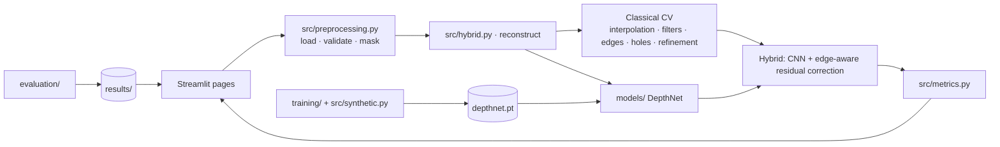

# DEPTHMAP AI

**Beyond Pixels. Preserving Geometry.**
Edge-preserving depth map upsampling and refinement — Computer Vision Hackathon 2026, Problem Statement 4 (P4).

DEPTHMAP AI turns sparse, noisy, incomplete or low-resolution depth maps into dense high-resolution depth maps using an
RGB guidance image. It contains seven reconstruction methods (three interpolation baselines, two edge-aware filters, a
PyTorch CNN, and a hybrid of CNN + classical filtering) in a Streamlit web app with evaluation, comparison and analytics.

> **Live app:** _not deployed yet — add your URL here after following [Deployment](#deployment)._
> **Evaluation:** [`eval_P4_TeamID.md`](eval_P4_TeamID.md) · **Architecture:** [`docs/architecture.md`](docs/architecture.md) · **Design:** [`docs/design_document.md`](docs/design_document.md)

---

## Results at a glance

20 held-out test scenes (procedural RGB-D, 320×240), noise σ = 1 % of depth, 10 % holes, identical settings for all methods.
Full tables with MAE, PSNR, SSIM, latency and memory: [`eval_P4_TeamID.md`](eval_P4_TeamID.md).

| Method | RMSE 2× | RMSE 4× | RMSE 8× | Boundary RMSE 4× | Edge F1 4× | Latency 4× (CPU) |
|---|---|---|---|---|---|---|
| Bicubic | 0.173 m | 0.249 m | 0.364 m | 0.719 m | 0.858 | 0.01 s |
| Joint bilateral filtering | 0.166 m | 0.218 m | 0.281 m | 0.636 m | 0.916 | 0.06 s |
| DepthNet (deep learning) | 0.077 m | 0.092 m | 0.125 m | 0.271 m | 0.958 | 0.11 s |
| **Hybrid** | **0.072 m** | **0.089 m** | **0.123 m** | **0.258 m** | **0.961** | 0.19 s |

Hybrid vs bicubic, averaged over 2×/4×/8×: **−63.9 % RMSE, −65.0 % boundary RMSE**.

⚠️ **Honest limitation:** all numbers are on *synthetic* scenes. NYU Depth V2 / Middlebury / KITTI could not be
downloaded in the build environment, so real-sensor accuracy has not been measured. Scripts to do it are included
(see [Training on real data](#training-on-real-data-nyu-depth-v2)).

---

## Problem statement

Build an intelligent system that converts sparse / noisy / low-resolution depth into dense high-resolution depth while
preserving object boundaries, geometric structure and depth discontinuities; reducing noise and filling holes; avoiding
oversmoothing and RGB texture-copy artifacts; supporting 2×, 4×, 8×; and comparing classical CV, deep learning and
hybrid reconstruction with appropriate metrics on unseen inputs.

## Features

| Area | What is implemented |
|---|---|
| Inputs | RGB (PNG/JPG), depth as 16-bit PNG, TIFF, `.npy`/`.npz`; unit scale (mm, KITTI ×256, metres); NaN/inf/0 → validity mask; colour or 8-bit "depth" detected and flagged as *relative*; RGB/depth size, aspect and edge-alignment checks; empty / corrupt upload errors |
| Classical CV | Mask-aware nearest / bilinear / bicubic · guided filter (colour, 3×3 covariance) · joint bilateral upsampling · Sobel, Canny, relative depth gradient, discontinuity detection, structure edges · edge-aware denoising · RGB-guided + push-pull hole filling · flying-pixel snapping |
| Deep learning | **DepthNet** — dual-branch residual encoder–decoder, gated RGB–depth fusion at 4 scales, multi-scale residual heads, 1.5 M params; full training / validation / checkpoint / inference pipeline |
| Hybrid | DepthNet + edge-aware data-fidelity correction (depth-guided joint bilateral upsampling of residuals at real measurements); optional RGB-JBU fusion and snapping stages; every stage viewable |
| Evaluation | RMSE, MAE, PSNR, SSIM, δ<1.25, Edge F1 (edge preservation), boundary RMSE (boundary accuracy), texture-copy index, coverage, latency, memory |
| App (7 pages) | Home · Dashboard (real session activity) · Reconstruction Studio · Comparison Lab · Analytics (Plotly) · Model info · About |
| Studio | 3 input modes (held-out samples, upload low-res depth, upload full-res depth + simulated sensor) · 2×/4×/8× · all settings live · progress · before/after slider · zoomable view · edge maps · pipeline stages · metrics or "unavailable" · downloads (16-bit PNG mm, `.npy` m, colour PNG, comparison sheet) |
| Quality | 111 automated tests (algorithms, metrics, model, every method × scale, downloads, every UI page, Run buttons) |

## Architecture



Details and the hybrid stage diagram: [`docs/architecture.md`](docs/architecture.md).

```
DEPTHMAP_AI/
├── app.py                  # Streamlit entry point (navigation, theme)
├── config.py               # paths, methods, limits
├── views/                  # (Streamlit pages) home, dashboard, reconstruction, comparison, analytics, model_info, about
├── src/
│   ├── preprocessing.py    # loading, validation, masks, sensor simulation
│   ├── interpolation.py    # nearest / bilinear / bicubic (mask-aware)
│   ├── filters.py          # guided filter, joint bilateral upsampling, denoising
│   ├── edge_detection.py   # Sobel, Canny, depth gradient, discontinuities, structure edges
│   ├── hole_filling.py     # guided fill, push-pull
│   ├── refinement.py       # weighted-median flying-pixel snapping
│   ├── hybrid.py           # Settings, reconstruct() for all 7 methods, hybrid pipeline
│   ├── metrics.py          # all metrics + latency/memory measurement
│   ├── synthetic.py        # procedural RGB-D scene generator
│   ├── visualization.py    # colourising, error maps, exports
│   └── ui.py               # shared UI components
├── models/                 # depth_model.py (DepthNet), inference.py, checkpoints/depthnet.pt
├── training/               # dataset.py, augmentations.py, train.py, evaluate.py, prepare_nyu.py
├── evaluation/             # benchmark.py, ablation.py, failure_analysis.py, write_report.py
├── results/                # saved metrics (json/md), training log, failure-case images
├── data/                   # samples/ (9 held-out demo scenes), upload_example/, make_samples.py
├── tests/                  # pytest suite
├── docs/                   # architecture.md, design_document.md
├── eval_P4_TeamID.md       # evaluation report (rename with your Team ID)
├── Dockerfile, requirements.txt, requirements-dev.txt, .streamlit/config.toml
```

## Installation

Requires Python 3.10–3.12 (3.13 also works locally).

```bash
git clone https://github.com/<your-username>/DEPTHMAP_AI.git
cd DEPTHMAP_AI
python -m venv .venv
# Windows: .venv\Scripts\activate      macOS/Linux: source .venv/bin/activate
pip install -r requirements-dev.txt
```

## Run

```bash
streamlit run app.py          # opens http://localhost:8501
```

or with Docker (one command):

```bash
docker build -t depthmap-ai . && docker run -p 7860:7860 depthmap-ai   # http://localhost:7860
```

**Try it:** open *Reconstruction Studio* → *Sample scene* → *Run Reconstruction*. To test the upload flow use the files in
`data/upload_example/` (RGB 512×384, low-res depth 128×96 in mm, ground truth) with scale 4×.

## Reproduce every result

```bash
pytest                                        # 111 tests
python data/make_samples.py                   # regenerate demo samples (deterministic)
python -m training.train --iters 2600 --batch 8 --max-minutes 32   # retrain DepthNet on CPU (~25 min)
python -m evaluation.benchmark --n 20         # results/benchmark.json + .md
python -m evaluation.ablation --n 12 --scale 4
python -m evaluation.failure_analysis --n 6 --scale 4
python -m evaluation.write_report             # rebuilds eval_P4_TeamID.md from the JSON files
```

## Dataset

* **Used:** procedural RGB-D scenes from `src/synthetic.py` — planes, curved objects, thin poles, textures, camouflage,
  shading; perfect ground truth. Seed ranges keep splits disjoint: train 0–99 999, validation 100 000–100 999,
  demo samples 200 003–200 099, benchmark 200 500+.
* **Supported (not run here):** NYU Depth V2 labelled subset via `training/prepare_nyu.py`; any folder of RGB + 16-bit
  depth PNGs via `FolderRGBD` (works for Middlebury / KITTI after conversion). Check each dataset's licence before use.

## Model

DepthNet (`models/depth_model.py`): RGB + normalised bicubic depth + confidence → dense depth (residual over bicubic).
Trained 2 600 iterations (batch 8, 128² crops, random 2×/4×/8×, noise, holes, sparsity, RGB dropout) in 24 min on a
2-core CPU. Validation RMSE (normalised) 0.0455 vs bicubic 0.0926. Training curve: *Model* page or
`models/checkpoints/depthnet.history.json`.

### Training on real data (NYU Depth V2)

Free Google Colab GPU is enough:

```bash
pip install -r requirements-dev.txt
wget http://horatio.cs.nyu.edu/mit/silberman/nyu_depth_v2/nyu_depth_v2_labeled.mat -P data/   # ~2.8 GB
python training/prepare_nyu.py --mat data/nyu_depth_v2_labeled.mat --out data/nyu
python -m training.train --data folder --root data/nyu/train --val-root data/nyu/val --iters 20000 --batch 16 --crop 256 --resume
python -m training.evaluate --root data/nyu/test --limit 200
```

## Evaluation

See [`eval_P4_TeamID.md`](eval_P4_TeamID.md): dataset details, setup, comparative tables for 2×/4×/8×, ablation
(9 variants) and failure analysis (8 stress cases, with images in `results/failure_cases/`).

## Limitations & ethics

* Synthetic-only training and testing; real-sensor performance unknown until the NYU scripts are run.
* **Misaligned RGB/depth** is a real failure mode: DepthNet then does worse than bicubic. The Studio shows an
  RGB–depth edge-agreement score; turn RGB guidance off if it is low.
* Under **heavy noise** the hybrid's measurement correction re-injects noise (DepthNet alone is better there).
* Hole filling and the CNN can produce plausible but wrong geometry in large holes; outputs carry validity masks
  (0 in PNG, NaN in `.npy`). Do not use for safety-critical decisions without real validation.
* Uploads are processed in memory and never stored. No secrets or credentials are used or committed.

## Deployment

**Option A — Streamlit Community Cloud (recommended, free):**
1. Push this folder to a public GitHub repository (see below).
2. Go to <https://share.streamlit.io> → *Create app* → pick the repo, branch `main`, main file `app.py`.
   Under *Advanced settings* choose Python 3.11 or 3.12. Deploy.
3. Open the URL on a laptop **and** a phone. Free apps sleep after inactivity — open it a few minutes before judging.

**Option B — Hugging Face Spaces (Docker):** create a Space with SDK *Docker*, push this repo to it. Add this block at
the very top of the Space's `README.md`:

```yaml
---
title: DEPTHMAP AI
emoji: 🌊
sdk: docker
app_port: 7860
---
```

**Publishing to GitHub:**

```bash
git init && git add . && git commit -m "DEPTHMAP AI"
git branch -M main
git remote add origin https://github.com/<your-username>/DEPTHMAP_AI.git
git push -u origin main
```

## Technologies

Python · Streamlit · PyTorch · OpenCV · NumPy · SciPy / scikit-image · Plotly · pandas · pytest · Docker.

## Team

Edit the first line of `eval_P4_TeamID.md` with your USNs (comma-separated) and rename the file to
`eval_P4_<TeamID>.md` (also update `OUT` / `USNS` in `evaluation/write_report.py`).
